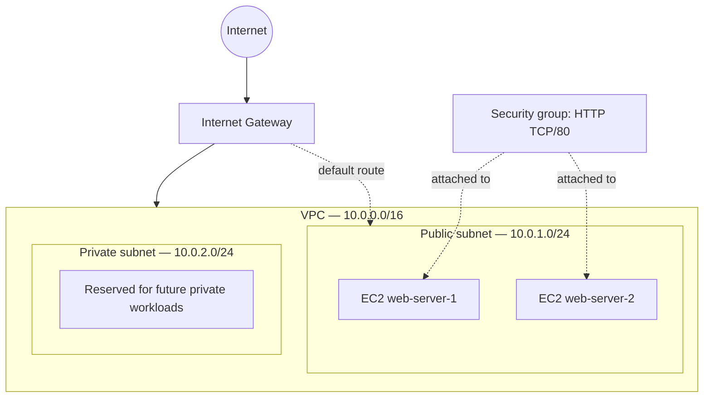

# Modular AWS Infrastructure Deployment with Terraform

> A hands-on Terraform learning project: provisioning AWS networking, security, and two EC2 web servers using reusable child modules.

## Project overview

In this project I demonstrate how to organize AWS infrastructure as code (IaC) with Terraform modules. The root module connects three child modules:

- **Network:** VPC, public and private subnets, internet gateway, and route tables.
- **Security group:** inbound HTTP access and outbound connectivity.
- **Compute:** two EC2 instances in the public subnet, configured with the same AMI and instance type.

The lab also covers Terraform variables and outputs, resource references, dependency resolution, EC2 user data, and troubleshooting an Availability Zone compatibility error.

## Architecture



**Routing:** The public subnet's route table has a `0.0.0.0/0` route to the internet gateway. The private subnet has a separate route table without an internet default route. A subnet is associated with one Availability Zone, while the VPC spans the Region.

> **Note:** The two EC2 instances are in the **same subnet/AZ**. This is not a multi-AZ high-availability deployment.

## Tools and prerequisites

- AWS account and permission to create VPC, EC2, networking, and security group resources
- Terraform CLI
- AWS CLI 
- An AWS AMI ID valid in the selected Region
- Basic familiarity with HCL and networking


## My Repository structure

```text
.
├── main.tf                    # Root module: Brings together the child modules
├── variables.tf               # Root input variable declarations
├── terraform.tfvars.example   # Example values; copy to terraform.tfvars
├── outputs.tf                 # Values displayed after deployment
├── providers.tf               # Terraform and AWS provider configuration
├── modules/
│   ├── network/
│   │   ├── main.tf
│   │   ├── variables.tf
│   │   └── outputs.tf
│   ├── security-group/
│   │   ├── main.tf
│   │   ├── variables.tf
│   │   └── outputs.tf
│   └── compute/
│       ├── main.tf
│       ├── variables.tf
│       └── outputs.tf
└── README.md
```

## What I built

### 1. Network module

The network module provisions:

| Resource | Purpose |
|---|---|
| VPC (`10.0.0.0/16`) | Isolated network for the lab |
| Public subnet (`10.0.1.0/24`) | Hosts internet-facing EC2 instances |
| Private subnet (`10.0.2.0/24`) | Reserved for future private workloads |
| Internet gateway | Connects the VPC to the internet |
| Public route table | Sends `0.0.0.0/0` traffic to the internet gateway |
| Private route table | Keeps only the VPC's local route by default |
| Route table associations | Attach each subnet to its intended route table |

Example of passing a resource attribute to another resource **within the same module**:

```hcl
resource "aws_internet_gateway" "internet_gw" {
  vpc_id = aws_vpc.main.id
}
```

The network module exposes outputs such as `vpc_id`, `public_subnet_id`, and `private_subnet_id` for other modules to consume.

### 2. Security group module

The security group is created in the VPC supplied by the network module:

```hcl
resource "aws_security_group" "main" {
  name        = var.security_group_name
  description = "Security group for EC2 instances"
  vpc_id      = var.vpc_id
}
```

This lab permits inbound **TCP port 80** from `0.0.0.0/0` and outbound IPv4 traffic to `0.0.0.0/0`. Port 80 is intentionally public so the sample webpages can be tested. For real deployments, restrict access to the minimum required.

The module exports its generated security group ID:

```hcl
output "security_group_id" {
  value = aws_security_group.main.id
}
```

### 3. Compute module

The compute module creates two EC2 instances using `count`. Both use the same AMI, instance type, public subnet, and security group.

```hcl
resource "aws_instance" "servers" {
  count = var.instance_count

  ami                         = var.ami
  instance_type               = var.instance_type
  subnet_id                   = var.subnet_id
  vpc_security_group_ids      = [var.security_group_id]
  associate_public_ip_address = true

  # Example for an Ubuntu/Debian-based AMI
  user_data = <<-EOF
  #!/bin/bash
  dnf install -y nginx
  systemctl enable --now nginx
  echo "<h1>Hello World from Server ${count.index + 1}</h1>" > /usr/share/nginx/html/index.html
EOF

  tags = {
    Name = "web-server-${count.index + 1}"
  }
}
```

`count.index` starts at zero, so adding one produces human-friendly names: `web-server-1` and `web-server-2`.


### 4. Root module: connecting everything

The root module passes the network outputs into the security group and compute modules:

```hcl
module "network" {
  source = "./modules/network"

  vpc_cidr                 = var.vpc_cidr
  public_subnet_cidr       = var.public_subnet_cidr
  private_subnet_cidr      = var.private_subnet_cidr
  public_availability_zone = var.public_availability_zone
}

module "security_group" {
  source = "./modules/security-group"

  vpc_id              = module.network.vpc_id
  security_group_name = "web-server-sg"
  ingress_cidr        = "0.0.0.0/0"
  ingress_from_port   = 80
  ingress_to_port     = 80
  ingress_protocol    = "tcp"
}

module "compute" {
  source = "./modules/compute"

  ami               = var.ami
  instance_type     = var.instance_type
  instance_count    = var.instance_count
  subnet_id         = module.network.public_subnet_id
  security_group_id = module.security_group.security_group_id
}
```

## Deployment walkthrough

1. **Configure credentials.** Use an AWS profile
2. **Choose the AWS Region and AMI.** AMI IDs are Region-specific. 
3. **Set root input variables.** Define values in `terraform.tfvars`. For example:

   ```hcl
   ami                      = "ami-xxxxxxxxxxxx"
   instance_type            = "t3.micro"
   instance_count           = 2
   public_availability_zone = "us-east-1a"
   ```

4. **Format and initialize the working directory.**

   ```bash
   terraform fmt -recursive
   terraform init
   ```

5. **Validate the proposed changes.**

   ```bash
   terraform validate
   terraform plan
   ```

6. **Deploy the resources.**

   ```bash
   terraform apply
   ```

7. **Inspect outputs.**

   ```bash
   terraform output
   terraform output ec2_public_ips
   ```

8. **Test the web servers.** Visit `http://<public-ip>` for each instance after its initialization completes. Check EC2 user-data/cloud-init logs if the page does not load.

9. **Clean up when finished.**

   ```bash
   terraform destroy
   ```

## Terraform concepts learned

| Concept | What I learned |
|---|---|
| Root module | The entry point that connects child modules |
| Child module | A reusable set of related Terraform resources |
| Input variable | Lets a module receive configurable values through `var.name` |
| Output | Exposes a value for another module or the user |
| Resource reference | Uses values from another resource, e.g. `aws_vpc.main.id` |
| Module reference | Uses a child module output, e.g. `module.network.vpc_id` |
| `count` | Creates multiple similar resources from one block |
| `count.index` | Identifies each resource instance, starting at zero |
| Splat expression `[*]` | Collects attributes from all count-created instances |
| Dependency graph | Terraform infers creation order from references |
| User data | Runs initialization commands when EC2 boots |
| State | Tracks Terraform-managed infrastructure; must be protected |

### A key lesson about module boundaries

A resource in the compute module cannot directly reference a resource declared inside the network module. Instead, the network module **outputs** the subnet ID, the root module **passes** it to compute, and compute **receives** it as an input variable:

```text
modules/network/outputs.tf
  public_subnet_id = aws_subnet.subnet_1_public.id
               ↓
root/main.tf
  subnet_id = module.network.public_subnet_id
               ↓
modules/compute/main.tf
  subnet_id = var.subnet_id
```

## Troubleshooting: unsupported instance type in an AZ

### Error encountered

```text
Unsupported: Your requested instance type (t3.micro) is not supported
in your requested Availability Zone (us-east-1e).
```

### Cause

My public subnet was placed in `us-east-1e`. The selected `t3.micro` instance type was unavailable in that AZ for the deployment. An EC2 instance must launch in the AZ of its subnet.

### Resolution

I explicitly selected an AZ reported as supported by AWS, such as `us-east-1a`, in the **public subnet** configuration:

```hcl
resource "aws_subnet" "subnet_1_public" {
  vpc_id                  = aws_vpc.main.id
  cidr_block              = var.public_subnet_cidr
  availability_zone       = var.public_availability_zone
  map_public_ip_on_launch = true
}
```

Then I reviewed the Terraform plan and applied the change. **Changing an existing subnet's AZ requires replacing that subnet**, so always inspect the plan before applying such a change to an environment with running workloads.

### Other issues encountered while learning

- **`ami = "var.ami"` versus `ami = var.ami`:** Quoted text is a literal string, not a variable reference.
- **`count.index` without `count`:** The resource must declare `count = var.instance_count` first.
- **Unexpected module argument:** An argument passed to a child module must be declared as an input variable in that module.
- **Incorrect resource reference:** Resource names in expressions must match the actual declared Terraform resource labels.
- **Outdated Python web server command:** Python 2's `SimpleHTTPServer` is not suitable for modern Python 3 images; a supported web server such as Nginx is a better lab choice.


## Reflection

This lab helped me understand how Terraform modules communicate using inputs and outputs, how AWS networking resources fit together, and why infrastructure troubleshooting requires understanding the cloud platform—not just the Terraform configuration. The Availability Zone error was especially useful: the Terraform code could be syntactically valid while the AWS deployment still failed due to an infrastructure constraint.

---

**Status:** Infrastructure deployment succeeded. 
